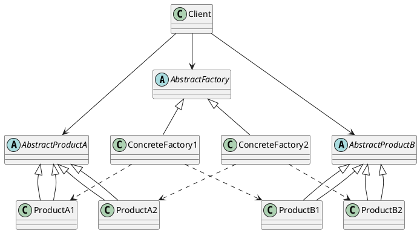
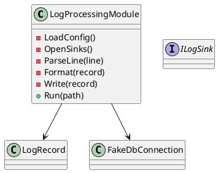
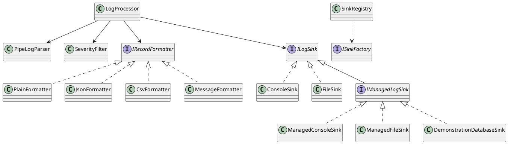

# Лабораторная работа 4. Git, среда и SOLID

**Студент:** Баиашвили Д. П., БИСО-01-24  
**Вариант:** 4 — Syslog RFC 5424; приёмники: консоль, файл.  
**Репозиторий:** https://github.com/Fiskr70/Lecture_Examples  
**Pull Request:** https://github.com/Fiskr70/Lecture_Examples/pull/1 (черновик, не слит).

## Задача

Подготовить среду и репозиторий для проекта LogHub. Изучить пример с несколькими обязанностями в одном классе, разделить его на слои и проверить разбор и маршрутизацию.

## Разбор кода примера Abstract Factory

В учебном примере `AbstractFactory.cs` клиент получает фабрику и через неё создаёт два связанных продукта. Конкретная фабрика выбирает семейство A1/B1 или A2/B2. Клиент вызывает общие операции и не создаёт конкретные продукты напрямую. Это позволяет переключать семейство заменой переданного объекта; абстракции фабрики и продуктов при этом остаются прежними. В самом демонстрационном коде совместимость выражена договорённостью конкретных фабрик и типами абстракций: жёсткая проверка всех возможных комбинаций типов отдельно не реализована.

## Нарушения в исходном коде

Номера строк относятся к [LogProcessingModule.cs](https://github.com/clgray/Lecture_Examples/blob/master/DesignPatterns/Implementation/_AntiPatterns/GodObject/LogProcessingModule.cs) из учебного репозитория.

| Принцип | Участок | Почему возникает проблема |
|---|---|---|
| SRP | `LoadConfig`, `OpenSinks`, `ParseLine`, `Format`, `Write`, `Run` | Конфигурация, хранение, разбор, формат и фильтр имеют разные причины изменения, но сосредоточены в одном классе. |
| OCP | строки 87–106 и 174–197 | Для нового приёмника нужно менять ветвления открытия и записи. |
| DIP | строка 40 и строки 206–215 | Бизнес-логика привязана к конкретному соединению и файловой системе, поэтому её нельзя изолировать простой подменой. |
| ISP | интерфейс в строке 264 | Консольному или файловому приёмнику навязываются операции транзакций, ротации и цвета, которые не относятся ко всем реализациям. |
| LSP | интерфейс в строке 264 | Такой интерфейс создаёт риск неподставляемости, если реализация вынуждена отказывать в части методов. Конкретных реализаций в исходном файле нет, поэтому фактическое нарушение подстановки здесь не доказано. |

## Диаграмма до изменения

## Диаграмма после изменения

## Применённые паттерны и решения

| Подход | Где | Почему |
|---|---|---|
| Фабрика приёмника | `ISinkFactory`, `SinkRegistry` | Реализация создаётся отдельно от конвейера. Регистрация осуществляется поиском фабрик в сборке, поэтому новый приёмник можно добавить отдельным файлом без правки `LogProcessor`. |
| Подстановка зависимости | `LogProcessor` | Тест может передать приёмник в памяти и проверить маршрутизацию без файла или сети. |

`PipeLogParser` сохраняет разделитель исходного учебного примера; Syslog RFC 5424 будет добавлен при выполнении работы по импорту. Форматирование и фильтрация вынесены в отдельные компоненты. Обработка получает источник как `IEnumerable<string>`, а не открывает файл самостоятельно.

## Ключевые решения

Разбор строки и шкала серьёзности пока имеют по одной реализации и представлены конкретными классами. У форматирования и записи уже несколько вариантов, поэтому обработчик зависит от интерфейсов. Новый приёмник добавляется отдельным классом с фабрикой, а смена формата вывода затрагивает форматировщик и его выбор в точке входа.

## Проверки

- Локально проверены remotes `origin` и `upstream`. Форк публичный, ветка `develop` используется по умолчанию, `main` защищена.
- В исходном `DesignPatterns` успешно выполнены сборка и запуски `--list`, `abstract-factory` и `god-object`. Предупреждения анализаторов относятся к учебному проекту.
- Собственное решение LogHub собрано в Release с `--warnaserror`: 0 ошибок и 0 предупреждений. Локальный MSTest: 8 из 8. Тесты проверяют разбор, фильтрацию, счётчики и маршрутизацию с приёмником в памяти.
- На входных строках демонстрации сопоставлены стандартный вывод, счётчики и байты файлов. Совпали 25 из 25 сценариев: настройки по умолчанию и сочетания 3 приёмников, 4 форматов и 2 порогов. В режиме по умолчанию записано 3 строки, пропущено 2.
- Для проверки OCP временно добавлен `PreviewSinkFactory.cs`. Команда `git diff --name-only` показала один новый файл. При `sink=preview` запись пришла в новый приёмник. Временный файл удалён после проверки.
- [GitHub Actions](https://github.com/Fiskr70/Lecture_Examples/pull/1/checks) запускает сборку и MSTest при изменениях ветки.

## Что не получилось

Черновик ожидает проверки преподавателя. Слияние веток и тег `v0.1.0` отложены до приёмки. RFC 5424 относится к этапу импорта, поэтому сравнение проведено на исходном учебном формате с разделителем `|`.

## Источники

- [Учебный репозиторий](https://github.com/clgray/Lecture_Examples), в том числе пример Abstract Factory и исходный класс для анализа.
- ChatGPT (OpenAI): помощь в подготовке кода, тестов и текста отчёта; результат требуется проверить и изучить перед защитой.
