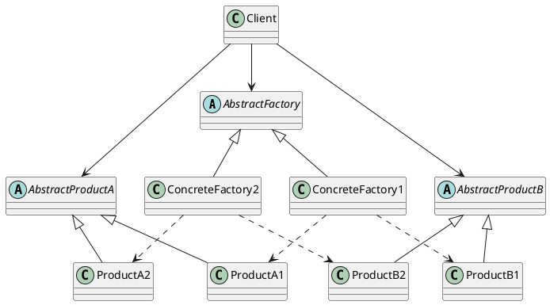
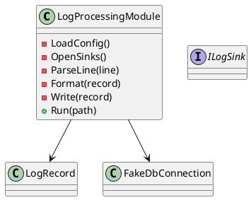
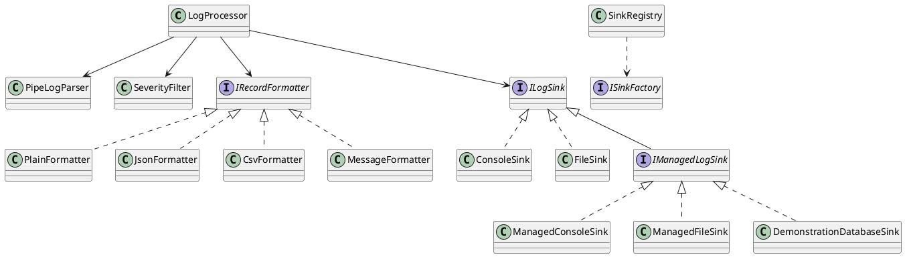

# Лабораторная работа 1. Git, среда и SOLID

**Студент:** Баиашвили Д. П., БИСО-01-24  
**Вариант:** 4 — Syslog RFC 5424; приёмники: консоль, файл.  
**Репозиторий:** https://github.com/Fiskr70/Lecture_Examples  
**Pull Request:** https://github.com/Fiskr70/Lecture_Examples/pull/1 (черновик, не слит).

## Задача

Подготовить среду и репозиторий для проекта LogHub. Изучить пример с несколькими обязанностями в одном классе, разделить его на слои и проверить разбор и маршрутизацию.

## Разбор кода примера Abstract Factory

В учебном примере `AbstractFactory.cs` клиент получает фабрику и через неё создаёт два связанных продукта. Конкретная фабрика выбирает семейство A1/B1 или A2/B2. Клиент вызывает общие операции и не создаёт конкретные продукты напрямую. Это позволяет переключать семейство заменой переданного объекта; абстракции фабрики и продуктов при этом остаются прежними. В самом демонстрационном коде совместимость выражена договорённостью конкретных фабрик и типами абстракций: жёсткая проверка всех возможных комбинаций типов отдельно не реализована.

## Нарушения в исходном коде

Номера строк относятся к [LogProcessingModule.cs](https://github.com/clgray/Lecture_Examples/blob/master/DesignPatterns/Implementation/_AntiPatterns/GodObject/LogProcessingModule.cs) из учебного репозитория.

| Принцип | Участок | Почему возникает проблема |
|---|---|---|
| SRP | `LoadConfig`, `OpenSinks`, `ParseLine`, `Format`, `Write`, `Run` | Конфигурация, хранение, разбор, формат и фильтр имеют разные причины изменения, но сосредоточены в одном классе. |
| OCP | строки 87–106 и 174–197 | Для нового приёмника нужно менять ветвления открытия и записи. |
| DIP | строка 40 и строки 206–215 | Бизнес-логика привязана к конкретному соединению и файловой системе, поэтому её нельзя изолировать простой подменой. |
| ISP | интерфейс в строке 264 | Консольному или файловому приёмнику навязываются операции транзакций, ротации и цвета, которые не относятся ко всем реализациям. |
| LSP | интерфейс в строке 264 | Такой интерфейс создаёт риск неподставляемости, если реализация вынуждена отказывать в части методов. Конкретных реализаций в исходном файле нет, поэтому фактическое нарушение подстановки здесь не доказано. |

## Диаграмма до изменения

## Диаграмма после изменения

## Применённые паттерны и решения

| Подход | Где | Почему |
|---|---|---|
| Фабрика приёмника | `ISinkFactory`, `SinkRegistry` | Реализация создаётся отдельно от конвейера. Регистрация осуществляется поиском фабрик в сборке, поэтому новый приёмник можно добавить отдельным файлом без правки `LogProcessor`. |
| Подстановка зависимости | `LogProcessor` | Тест может передать приёмник в памяти и проверить маршрутизацию без файла или сети. |

`PipeLogParser` сохраняет разделитель исходного учебного примера; Syslog RFC 5424 будет добавлен при выполнении работы по импорту. Форматирование и фильтрация вынесены в отдельные компоненты. Обработка получает источник как `IEnumerable<string>`, а не открывает файл самостоятельно.

## Проверки

- Локальная сборка `LogHub.csproj` прошла без ошибок и предупреждений.
- Десять автономных проверок парсера, фильтра, форматирования и маршрутизации прошли без файловой системы; они запускаются отдельной программой `OfflineChecks`, а не через MSTest.
- Вывод исходного класса преподавателя и нового конвейера сравнен на одном файле для настроек по умолчанию: три записи записаны, три пропущены; текст совпал.
- В GitHub Actions успешно прошли сборка решения с `--warnaserror` (0 ошибок и 0 предупреждений) и восемь тестов MSTest: 8 из 8. Исходный учебный проект также прошёл свой workflow. Результаты: https://github.com/Fiskr70/Lecture_Examples/actions/runs/45419030078.

## Что не получилось и что осталось проверить

Из-за ограничений сетевого доступа локальный клон и восстановление пакетов MSTest на компьютере пока не выполнены: сборка и тесты решения запускались на GitHub Actions. Полное совпадение поведения всех режимов и обработка ошибок не проверены, а сравнение с исходным классом проведено только для конфигурации по умолчанию. Входной формат варианта RFC 5424 и демонстрационный набор 50–100 строк относятся к последующему этапу импорта. Необходимо дополнить отдельный отчёт фактическими скриншотами и получить проверку преподавателя.

## Источники

- [Учебный репозиторий](https://github.com/clgray/Lecture_Examples), в том числе пример Abstract Factory и исходный класс для анализа.
- ChatGPT (OpenAI): помощь в подготовке кода, тестов и текста отчёта; результат требуется проверить и изучить перед защитой.
