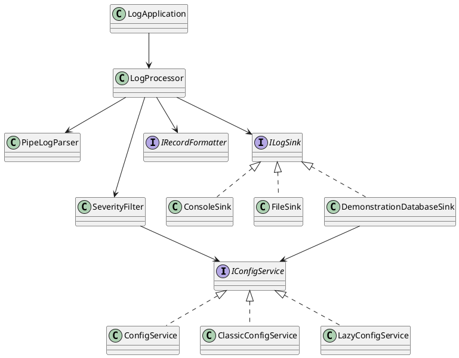

# Лабораторная работа 5. IoC, DI и Singleton

**Студент:** Баиашвили Д. П., БИСО-01-24  
**Вариант:** 4 — Syslog RFC 5424; приёмники: консоль, файл  
**Репозиторий:** https://github.com/Fiskr70/Lecture_Examples  
**Pull Request:** https://github.com/Fiskr70/Lecture_Examples/pull/2 (черновик)

## Задача

Реализовать три варианта хранения конфигурации, выявить зависимость тестов от глобального состояния и собрать компоненты LogHub через контейнер. Предусмотреть выбор консольного или файлового приёмника через файл конфигурации.

## Диаграмма классов

## Применённые паттерны

| Паттерн / механизм | Где применён | Почему |
|---|---|---|
| Singleton | ClassicConfigService и LazyConfigService | Демонстрирует глобальный экземпляр и сохранение состояния между вызовами; нужен для сравнения изоляции в тестах. |
| DI / IoC | Program.cs, LogApplication и LogProcessor | Состав приложения задаётся при запуске; обработчик не создаёт и не выбирает собственный приёмник и форматировщик. |
| Singleton в DI | Регистрация IConfigService в Program.cs | Один объект на контейнер и изоляция между контейнерами; класс конфигурации не требует глобальной точки доступа. |

## Ключевые решения

* ClassicConfigService использует блокировку при каждом запросе экземпляра: это проще проверить, чем двойную проверку без корректной публикации объекта.
* LazyConfigService использует встроенную потокобезопасную инициализацию Lazy<T>.
* В Program.cs выбираются и регистрируются типы, а контейнер создаёт сервисы и освобождает приёмники. SinkRegistry сопоставляет имя из конфигурации с типом по атрибуту SinkName. Фильтр и имитация базы получают IConfigService через конструктор. Единственное обращение к провайдеру разрешает LogApplication в точке входа.
* ConfigService — обычный класс: тест может построить отдельный контейнер или подставить IConfigService без сброса глобального состояния.

## Тесты

- [ConfigTests.cs](../LogHub.Tests/ConfigTests.cs): ClassicWritesStateThatCanLeak записывает ключ в классический Singleton. ClassicExpectedEmptyState ожидает, что этого ключа нет.
- При временном снятии Ignore отдельный запуск с фильтром `FullyQualifiedName~ClassicExpectedEmptyState` прошёл (1 из 1). При запуске всего набора в одном процессе тест выполнился после записи в Singleton и упал на Assert.IsNull: 14 прошли, 1 упал. Порядок стандартного запуска MSTest может различаться, поэтому есть и самостоятельная проверка ClassicOrderDependenceIsReproduced, которая воспроизводит эффект в заданной последовательности.
- После возврата Ignore обычный запуск завершён успешно: 14 прошли, 1 намеренно пропущен. SeparateContainersHaveSeparateSingletons подтвердил общий экземпляр внутри контейнера и независимые значения между двумя контейнерами.
- Проверены оба профиля: с `console.config` строка появилась в консоли, с `file.config` — в файле. Между запусками менялись только настройки. В 25 сценариях на строках учебного примера совпали вывод, счётчики и содержимое файлов. Сборка Release: 0 предупреждений и 0 ошибок.

## Что не получилось

Черновик основан на ветке предыдущей работы и ожидает проверки. Два класса с Instance() нужны, чтобы сравнить варианты на тестах. Рабочий LogHub получает ConfigService из DI. Импорт Syslog RFC 5424 относится к следующему этапу.

## Источники

Методические указания; учебный репозиторий https://github.com/clgray/Lecture_Examples; помощь ChatGPT при подготовке кода и отчёта.
