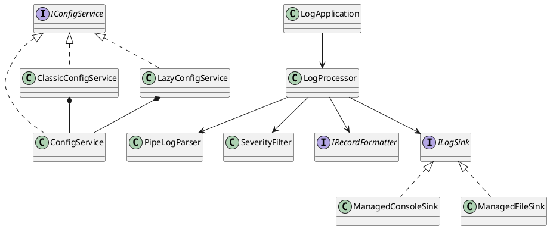

# Лабораторная работа 5. IoC, DI и Singleton

**Студент:** Баиашвили Д. П., БИСО-01-24  
**Вариант:** 4 — Syslog RFC 5424; приёмники: консоль, файл  
**Репозиторий:** https://github.com/Fiskr70/Lecture_Examples  
**Pull Request:** https://github.com/Fiskr70/Lecture_Examples/pull/2 (черновик)

## Задача

Реализовать три варианта хранения конфигурации, выявить зависимость тестов от глобального состояния и собрать компоненты LogHub через контейнер. Предусмотреть выбор консольного или файлового приёмника через файл конфигурации.

## Диаграмма классов

## Применённые паттерны

| Паттерн / механизм | Где применён | Почему |
|---|---|---|
| Singleton | ClassicConfigService и LazyConfigService | Демонстрирует глобальный экземпляр и сохранение состояния между вызовами; нужен для сравнения изоляции в тестах. |
| DI / IoC | Program.cs, LogApplication и LogProcessor | Состав приложения задаётся при запуске; обработчик не создаёт и не выбирает собственный приёмник и форматировщик. |
| Singleton в DI | Регистрация IConfigService в Program.cs | Один объект на контейнер и изоляция между контейнерами; класс конфигурации не требует глобальной точки доступа. |

## Ключевые решения

* ClassicConfigService использует блокировку при каждом запросе экземпляра: это проще проверить, чем двойную проверку без корректной публикации объекта.
* LazyConfigService использует встроенную потокобезопасную инициализацию Lazy<T>.
* Создание и выбор зависимостей сосредоточены в Program.cs. Файл loghub.config выбирает sink=console или sink=file без пересборки. Контейнер строится один раз, приложение получается из него в точке входа.
* ConfigService — обычный класс: тест может построить отдельный контейнер или подставить IConfigService без сброса глобального состояния.

## Тесты

* ClassicInstanceIsShared и LazyInstanceIsShared проверяют единый экземпляр и запись значений.
* ClassicOrderDependenceIsReproduced сначала проверяет отсутствие уникального ключа, затем записывает его и подтверждает, что повторная проверка выбрасывает AssertFailedException. Так одна и та же проверка показана до и после изменения глобального состояния в одном процессе.
* ClassicExpectedEmptyState оставлен с Ignore: если его включить и запустить после ClassicWritesStateThatCanLeak, состояние может перейти из другого теста. Реальный порядок отдельных тестов средой MSTest не гарантируется; результат тестового набора после снятия Ignore зависит от порядка и отдельно не воспроизводился.
* SeparateContainersHaveSeparateSingletons проверяет повторное использование внутри одного контейнера и независимость двух контейнеров.
* В проекте также есть тесты разбора, фильтра и обработки записей из предыдущей работы.

## Что не получилось

Локальный запуск MSTest на компьютере блокируется отсутствующими пакетами NuGet; запуск используется через GitHub Actions. Тест с Ignore не запускался отдельным процессом и в общем наборе со снятым Ignore. Предыдущая работа остаётся черновой, поэтому текущая ветка включает и её изменения. Импорт Syslog RFC 5424 в базовом каркасе пока не реализован; он относится к следующему этапу практикума.

## Источники

Методические указания; учебный репозиторий https://github.com/clgray/Lecture_Examples; помощь ChatGPT при подготовке кода и отчёта.
